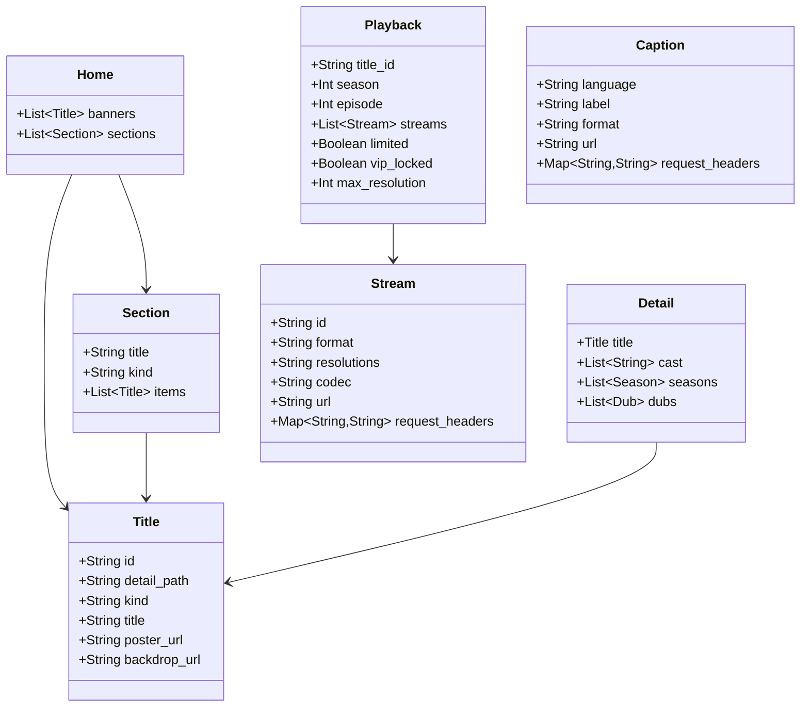

# NEXAPREMIUM — COMPLETE BACKEND API AUDIT & SPECIFICATION

**Target Service:** `https://movie-box-sepia-six.vercel.app`  
**API Title:** MovieBox scraper  
**API Version:** 1.0.0  
**OpenAPI Version:** 3.1.0  
**Deployment Environment:** Vercel Serverless (Python FastAPI / Starlette)  
**Audit Date:** November 2026  

---

## 1. EXECUTIVE SUMMARY & ARCHITECTURAL DISCOVERY

### 1.1 Backend System Stack
- **Framework & Runtime:** Python 3.x with **FastAPI** running on **Starlette/Uvicorn**.
- **Server Infrastructure:** Hosted on **Vercel Serverless Functions** (`Server: Vercel`, `X-Vercel-Cache: MISS`).
- **Upstream Source Provider:** Aggregates and scrapes content from **MovieBox** (`themoviebox.xyz`).
- **Content Delivery Networks (CDNs):**
  - **Poster & Backdrop Images:** `pbcdnw.aoneroom.com` (Direct standard JPEG delivery).
  - **Video Streams:** `bcdnxw.hakunaymatata.com` (MP4 video streams) and `sbcdnw.hakunaymatata.com` (DASH manifests).
  - **Subtitles:** `cacdn.hakunaymatata.com` (SRT subtitles protected by AWS CloudFront Signed URLs).

### 1.2 Practical Authorization Analysis
- **OpenAPI Specification Definition:** Every endpoint under `/v1/*` lists an optional HTTP header parameter `authorization` (Header, string, nullable).
- **Practical Runtime Testing:**
  - Tested `/v1/titles/{path}/playback` without any `Authorization` header.
  - Tested `/v1/titles/{path}/playback` with `Authorization: Bearer test_token`.
  - Tested `/v1/titles/{path}/playback` with `Authorization: VIP_TOKEN_XYZ`.
- **Finding:** In practice, **Authorization is 100% optional**. Requests without headers return identical playback URLs, resolution limits (`max_resolution: 480` or `1080`), and stream metadata as requests with arbitrary authorization tokens.

---

## 2. ENDPOINT DIRECTORY (ALL 16 ENDPOINTS)

### GET `/health`
- **Summary:** Health
- **Operation ID:** `health_health_get`
- **Tags:** None

#### Parameters:
  *No parameters required.*

#### Response Status Codes & Models:
| Status Code | Description | Content Schema |
| :--- | :--- | :--- |
| `200` | Successful Response | `Health` |

---

### GET `/v1/home`
- **Summary:** Home
- **Operation ID:** `home_v1_home_get`
- **Tags:** None

#### Parameters:
| Name | In | Required | Type | Description | Schema / Default |
| :--- | :--- | :--- | :--- | :--- | :--- |
| `authorization` | header | No | `string` | Authorization | Default: `N/A` |

#### Response Status Codes & Models:
| Status Code | Description | Content Schema |
| :--- | :--- | :--- |
| `200` | Successful Response | `Home` |
| `422` | Validation Error | `HTTPValidationError` |

---

### GET `/v1/collections/{name}`
- **Summary:** Collection
- **Operation ID:** `collection_v1_collections__name__get`
- **Tags:** None

#### Parameters:
| Name | In | Required | Type | Description | Schema / Default |
| :--- | :--- | :--- | :--- | :--- | :--- |
| `name` | path | Yes | `string` | Name | Default: `N/A` |
| `authorization` | header | No | `string` | Authorization | Default: `N/A` |

#### Response Status Codes & Models:
| Status Code | Description | Content Schema |
| :--- | :--- | :--- |
| `200` | Successful Response | `Home` |
| `422` | Validation Error | `HTTPValidationError` |

---

### GET `/v1/browse`
- **Summary:** Browse
- **Operation ID:** `browse_v1_browse_get`
- **Tags:** None

#### Parameters:
| Name | In | Required | Type | Description | Schema / Default |
| :--- | :--- | :--- | :--- | :--- | :--- |
| `page` | query | No | `integer` | Page | Default: `1` |
| `kind` | query | No | `string` | Kind | Default: `N/A` |
| `tab` | query | No | `string` | Tab | Default: `N/A` |
| `authorization` | header | No | `string` | Authorization | Default: `N/A` |

#### Response Status Codes & Models:
| Status Code | Description | Content Schema |
| :--- | :--- | :--- |
| `200` | Successful Response | `Page` |
| `422` | Validation Error | `HTTPValidationError` |

---

### GET `/v1/catalog/{name}/filters`
- **Summary:** Catalog Filters
- **Operation ID:** `catalog_filters_v1_catalog__name__filters_get`
- **Tags:** None

#### Parameters:
| Name | In | Required | Type | Description | Schema / Default |
| :--- | :--- | :--- | :--- | :--- | :--- |
| `name` | path | Yes | `string` | Name | Default: `N/A` |
| `authorization` | header | No | `string` | Authorization | Default: `N/A` |

#### Response Status Codes & Models:
| Status Code | Description | Content Schema |
| :--- | :--- | :--- |
| `200` | Successful Response | `CatalogFilters` |
| `422` | Validation Error | `HTTPValidationError` |

---

### GET `/v1/catalog/{name}`
- **Summary:** Catalog
- **Operation ID:** `catalog_v1_catalog__name__get`
- **Tags:** None

#### Parameters:
| Name | In | Required | Type | Description | Schema / Default |
| :--- | :--- | :--- | :--- | :--- | :--- |
| `name` | path | Yes | `string` | Name | Default: `N/A` |
| `page` | query | No | `integer` | Page | Default: `1` |
| `genre` | query | No | `string` | Genre | Default: `N/A` |
| `country` | query | No | `string` | Country | Default: `N/A` |
| `year` | query | No | `string` | Year | Default: `N/A` |
| `language` | query | No | `string` | Language | Default: `N/A` |
| `sort` | query | No | `string` | Sort | Default: `N/A` |
| `authorization` | header | No | `string` | Authorization | Default: `N/A` |

#### Response Status Codes & Models:
| Status Code | Description | Content Schema |
| :--- | :--- | :--- |
| `200` | Successful Response | `Page` |
| `422` | Validation Error | `HTTPValidationError` |

---

### GET `/v1/rankings`
- **Summary:** Rankings
- **Operation ID:** `rankings_v1_rankings_get`
- **Tags:** None

#### Parameters:
| Name | In | Required | Type | Description | Schema / Default |
| :--- | :--- | :--- | :--- | :--- | :--- |
| `authorization` | header | No | `string` | Authorization | Default: `N/A` |

#### Response Status Codes & Models:
| Status Code | Description | Content Schema |
| :--- | :--- | :--- |
| `200` | Successful Response | `Array<Ranking>` |
| `422` | Validation Error | `HTTPValidationError` |

---

### GET `/v1/rankings/{ranking_id}`
- **Summary:** Ranking
- **Operation ID:** `ranking_v1_rankings__ranking_id__get`
- **Tags:** None

#### Parameters:
| Name | In | Required | Type | Description | Schema / Default |
| :--- | :--- | :--- | :--- | :--- | :--- |
| `ranking_id` | path | Yes | `string` | Ranking Id | Default: `N/A` |
| `page` | query | No | `integer` | Page | Default: `1` |
| `authorization` | header | No | `string` | Authorization | Default: `N/A` |

#### Response Status Codes & Models:
| Status Code | Description | Content Schema |
| :--- | :--- | :--- |
| `200` | Successful Response | `Page` |
| `422` | Validation Error | `HTTPValidationError` |

---

### GET `/v1/search`
- **Summary:** Search
- **Operation ID:** `search_v1_search_get`
- **Tags:** None

#### Parameters:
| Name | In | Required | Type | Description | Schema / Default |
| :--- | :--- | :--- | :--- | :--- | :--- |
| `q` | query | Yes | `string` | Q | Default: `N/A` |
| `page` | query | No | `integer` | Page | Default: `1` |
| `authorization` | header | No | `string` | Authorization | Default: `N/A` |

#### Response Status Codes & Models:
| Status Code | Description | Content Schema |
| :--- | :--- | :--- |
| `200` | Successful Response | `Page` |
| `422` | Validation Error | `HTTPValidationError` |

---

### GET `/v1/search/suggestions`
- **Summary:** Suggestions
- **Operation ID:** `suggestions_v1_search_suggestions_get`
- **Tags:** None

#### Parameters:
| Name | In | Required | Type | Description | Schema / Default |
| :--- | :--- | :--- | :--- | :--- | :--- |
| `q` | query | Yes | `string` | Q | Default: `N/A` |
| `authorization` | header | No | `string` | Authorization | Default: `N/A` |

#### Response Status Codes & Models:
| Status Code | Description | Content Schema |
| :--- | :--- | :--- |
| `200` | Successful Response | `Array<>` |
| `422` | Validation Error | `HTTPValidationError` |

---

### GET `/v1/search/popular`
- **Summary:** Popular Searches
- **Operation ID:** `popular_searches_v1_search_popular_get`
- **Tags:** None

#### Parameters:
| Name | In | Required | Type | Description | Schema / Default |
| :--- | :--- | :--- | :--- | :--- | :--- |
| `authorization` | header | No | `string` | Authorization | Default: `N/A` |

#### Response Status Codes & Models:
| Status Code | Description | Content Schema |
| :--- | :--- | :--- |
| `200` | Successful Response | `Array<>` |
| `422` | Validation Error | `HTTPValidationError` |

---

### GET `/v1/titles/{detail_path}`
- **Summary:** Detail
- **Operation ID:** `detail_v1_titles__detail_path__get`
- **Tags:** None

#### Parameters:
| Name | In | Required | Type | Description | Schema / Default |
| :--- | :--- | :--- | :--- | :--- | :--- |
| `detail_path` | path | Yes | `string` | Detail Path | Default: `N/A` |
| `authorization` | header | No | `string` | Authorization | Default: `N/A` |

#### Response Status Codes & Models:
| Status Code | Description | Content Schema |
| :--- | :--- | :--- |
| `200` | Successful Response | `Detail` |
| `422` | Validation Error | `HTTPValidationError` |

---

### GET `/v1/titles/{detail_path}/episodes`
- **Summary:** Episodes
- **Operation ID:** `episodes_v1_titles__detail_path__episodes_get`
- **Tags:** None

#### Parameters:
| Name | In | Required | Type | Description | Schema / Default |
| :--- | :--- | :--- | :--- | :--- | :--- |
| `detail_path` | path | Yes | `string` | Detail Path | Default: `N/A` |
| `season` | query | Yes | `integer` | Season | Default: `N/A` |
| `authorization` | header | No | `string` | Authorization | Default: `N/A` |

#### Response Status Codes & Models:
| Status Code | Description | Content Schema |
| :--- | :--- | :--- |
| `200` | Successful Response | `Array<Episode>` |
| `422` | Validation Error | `HTTPValidationError` |

---

### GET `/v1/titles/{detail_path}/recommendations`
- **Summary:** Recommendations
- **Operation ID:** `recommendations_v1_titles__detail_path__recommendations_get`
- **Tags:** None

#### Parameters:
| Name | In | Required | Type | Description | Schema / Default |
| :--- | :--- | :--- | :--- | :--- | :--- |
| `detail_path` | path | Yes | `string` | Detail Path | Default: `N/A` |
| `page` | query | No | `integer` | Page | Default: `1` |
| `authorization` | header | No | `string` | Authorization | Default: `N/A` |

#### Response Status Codes & Models:
| Status Code | Description | Content Schema |
| :--- | :--- | :--- |
| `200` | Successful Response | `Page` |
| `422` | Validation Error | `HTTPValidationError` |

---

### GET `/v1/titles/{detail_path}/playback`
- **Summary:** Playback
- **Operation ID:** `playback_v1_titles__detail_path__playback_get`
- **Tags:** None

#### Parameters:
| Name | In | Required | Type | Description | Schema / Default |
| :--- | :--- | :--- | :--- | :--- | :--- |
| `detail_path` | path | Yes | `string` | Detail Path | Default: `N/A` |
| `season` | query | No | `integer` | Season | Default: `0` |
| `episode` | query | No | `integer` | Episode | Default: `0` |
| `authorization` | header | No | `string` | Authorization | Default: `N/A` |

#### Response Status Codes & Models:
| Status Code | Description | Content Schema |
| :--- | :--- | :--- |
| `200` | Successful Response | `Playback` |
| `422` | Validation Error | `HTTPValidationError` |

---

### GET `/v1/titles/{detail_path}/captions`
- **Summary:** Captions
- **Operation ID:** `captions_v1_titles__detail_path__captions_get`
- **Tags:** None

#### Parameters:
| Name | In | Required | Type | Description | Schema / Default |
| :--- | :--- | :--- | :--- | :--- | :--- |
| `detail_path` | path | Yes | `string` | Detail Path | Default: `N/A` |
| `stream_id` | query | Yes | `string` | Stream Id | Default: `N/A` |
| `season` | query | No | `integer` | Season | Default: `0` |
| `episode` | query | No | `integer` | Episode | Default: `0` |
| `authorization` | header | No | `string` | Authorization | Default: `N/A` |

#### Response Status Codes & Models:
| Status Code | Description | Content Schema |
| :--- | :--- | :--- |
| `200` | Successful Response | `Array<Caption>` |
| `422` | Validation Error | `HTTPValidationError` |

---

## 3. OPENAPI SCHEMAS & DATA MODELS (ALL 18 SCHEMAS)

### Schema: `Caption`
- **Type:** `object`
- **Required Properties:** `language`, `label`, `format`, `url`

| Property | Type | Required | Description / Item Schema |
| :--- | :--- | :--- | :--- |
| `language` | `string` | Yes | Language |
| `label` | `string` | Yes | Label |
| `format` | `string` | Yes | Format |
| `url` | `string` | Yes | Url |
| `size_bytes` | `Nullable<integer>` | No | Size Bytes |
| `delay_ms` | `integer` | No | Delay Ms |
| `request_headers` | `Map<String, String>` | No | Request Headers |

### Schema: `CatalogFilters`
- **Type:** `object`
- **Required Properties:** `groups`

| Property | Type | Required | Description / Item Schema |
| :--- | :--- | :--- | :--- |
| `groups` | `Array<[FilterGroup](#schema-filtergroup)>` | Yes | Groups |

### Schema: `Detail`
- **Type:** `object`
- **Required Properties:** `title`

| Property | Type | Required | Description / Item Schema |
| :--- | :--- | :--- | :--- |
| `title` | `Ref: [Title](#schema-title)` | Yes |  |
| `cast` | `Array<object>` | No | Cast |
| `seasons` | `Array<[Season](#schema-season)>` | No | Seasons |
| `dubs` | `Array<[Dub](#schema-dub)>` | No | Dubs |
| `trailer_url` | `Nullable<string>` | No | Trailer Url |

### Schema: `Dub`
- **Type:** `object`
- **Required Properties:** `id`, `detail_path`, `language`, `label`, `original`

| Property | Type | Required | Description / Item Schema |
| :--- | :--- | :--- | :--- |
| `id` | `string` | Yes | Id |
| `detail_path` | `string` | Yes | Detail Path |
| `language` | `string` | Yes | Language |
| `label` | `string` | Yes | Label |
| `original` | `boolean` | Yes | Original |

### Schema: `Episode`
- **Type:** `object`
- **Required Properties:** `season`, `number`

| Property | Type | Required | Description / Item Schema |
| :--- | :--- | :--- | :--- |
| `season` | `integer` | Yes | Season |
| `number` | `integer` | Yes | Number |

### Schema: `FilterGroup`
- **Type:** `object`
- **Required Properties:** `key`, `label`, `values`

| Property | Type | Required | Description / Item Schema |
| :--- | :--- | :--- | :--- |
| `key` | `string` | Yes | Key |
| `label` | `string` | Yes | Label |
| `values` | `Array<[FilterValue](#schema-filtervalue)>` | Yes | Values |

### Schema: `FilterValue`
- **Type:** `object`
- **Required Properties:** `id`, `label`

| Property | Type | Required | Description / Item Schema |
| :--- | :--- | :--- | :--- |
| `id` | `string` | Yes | Id |
| `label` | `string` | Yes | Label |

### Schema: `HTTPValidationError`
- **Type:** `object`
- **Required Properties:** None

| Property | Type | Required | Description / Item Schema |
| :--- | :--- | :--- | :--- |
| `detail` | `Array<[ValidationError](#schema-validationerror)>` | No | Detail |

### Schema: `Health`
- **Type:** `object`
- **Required Properties:** None

| Property | Type | Required | Description / Item Schema |
| :--- | :--- | :--- | :--- |
| `status` | `string` | No | Status |

### Schema: `Home`
- **Type:** `object`
- **Required Properties:** `banners`, `sections`

| Property | Type | Required | Description / Item Schema |
| :--- | :--- | :--- | :--- |
| `banners` | `Array<[Title](#schema-title)>` | Yes | Banners |
| `sections` | `Array<[Section](#schema-section)>` | Yes | Sections |

### Schema: `Page`
- **Type:** `object`
- **Required Properties:** `items`

| Property | Type | Required | Description / Item Schema |
| :--- | :--- | :--- | :--- |
| `items` | `Array<[Title](#schema-title)>` | Yes | Items |
| `page` | `integer` | No | Page |
| `next_page` | `Nullable<integer>` | No | Next Page |
| `has_more` | `boolean` | No | Has More |

### Schema: `Playback`
- **Type:** `object`
- **Required Properties:** `title_id`, `season`, `episode`, `streams`

| Property | Type | Required | Description / Item Schema |
| :--- | :--- | :--- | :--- |
| `title_id` | `string` | Yes | Title Id |
| `season` | `integer` | Yes | Season |
| `episode` | `integer` | Yes | Episode |
| `streams` | `Array<[Stream](#schema-stream)>` | Yes | Streams |
| `limited` | `boolean` | No | Limited |
| `vip_locked` | `boolean` | No | Vip Locked |
| `max_resolution` | `Nullable<integer>` | No | Max Resolution |

### Schema: `Ranking`
- **Type:** `object`
- **Required Properties:** `id`, `name`

| Property | Type | Required | Description / Item Schema |
| :--- | :--- | :--- | :--- |
| `id` | `string` | Yes | Id |
| `name` | `string` | Yes | Name |

### Schema: `Season`
- **Type:** `object`
- **Required Properties:** `number`, `episode_count`, `resolutions`

| Property | Type | Required | Description / Item Schema |
| :--- | :--- | :--- | :--- |
| `number` | `integer` | Yes | Number |
| `episode_count` | `integer` | Yes | Episode Count |
| `resolutions` | `Array<integer>` | Yes | Resolutions |

### Schema: `Section`
- **Type:** `object`
- **Required Properties:** `title`, `kind`, `items`

| Property | Type | Required | Description / Item Schema |
| :--- | :--- | :--- | :--- |
| `title` | `string` | Yes | Title |
| `kind` | `string` | Yes | Kind |
| `items` | `Array<[Title](#schema-title)>` | Yes | Items |

### Schema: `Stream`
- **Type:** `object`
- **Required Properties:** `id`, `format`, `resolutions`, `url`

| Property | Type | Required | Description / Item Schema |
| :--- | :--- | :--- | :--- |
| `id` | `string` | Yes | Id |
| `format` | `string` | Yes | Format |
| `resolutions` | `string` | Yes | Resolutions |
| `codec` | `Nullable<string>` | No | Codec |
| `size_bytes` | `Nullable<integer>` | No | Size Bytes |
| `duration_seconds` | `Nullable<integer>` | No | Duration Seconds |
| `url` | `string` | Yes | Url |
| `request_headers` | `Map<String, String>` | No | Request Headers |
| `vip_locked` | `boolean` | No | Vip Locked |

### Schema: `Title`
- **Type:** `object`
- **Required Properties:** `id`, `detail_path`, `kind`, `title`

| Property | Type | Required | Description / Item Schema |
| :--- | :--- | :--- | :--- |
| `id` | `string` | Yes | Id |
| `detail_path` | `string` | Yes | Detail Path |
| `kind` | `string` | Yes | Kind |
| `title` | `string` | Yes | Title |
| `description` | `string` | No | Description |
| `release_date` | `Nullable<string>` | No | Release Date |
| `duration_seconds` | `Nullable<integer>` | No | Duration Seconds |
| `genres` | `Array<string>` | No | Genres |
| `poster_url` | `Nullable<string>` | No | Poster Url |
| `backdrop_url` | `Nullable<string>` | No | Backdrop Url |
| `country` | `Nullable<string>` | No | Country |
| `rating` | `Nullable<string>` | No | Rating |
| `has_resource` | `boolean` | No | Has Resource |

### Schema: `ValidationError`
- **Type:** `object`
- **Required Properties:** `loc`, `msg`, `type`

| Property | Type | Required | Description / Item Schema |
| :--- | :--- | :--- | :--- |
| `loc` | `Array<Any>` | Yes | Location |
| `msg` | `string` | Yes | Message |
| `type` | `string` | Yes | Error Type |

## 4. DOMAIN DATA RELATIONSHIPS & AGGREGATION

